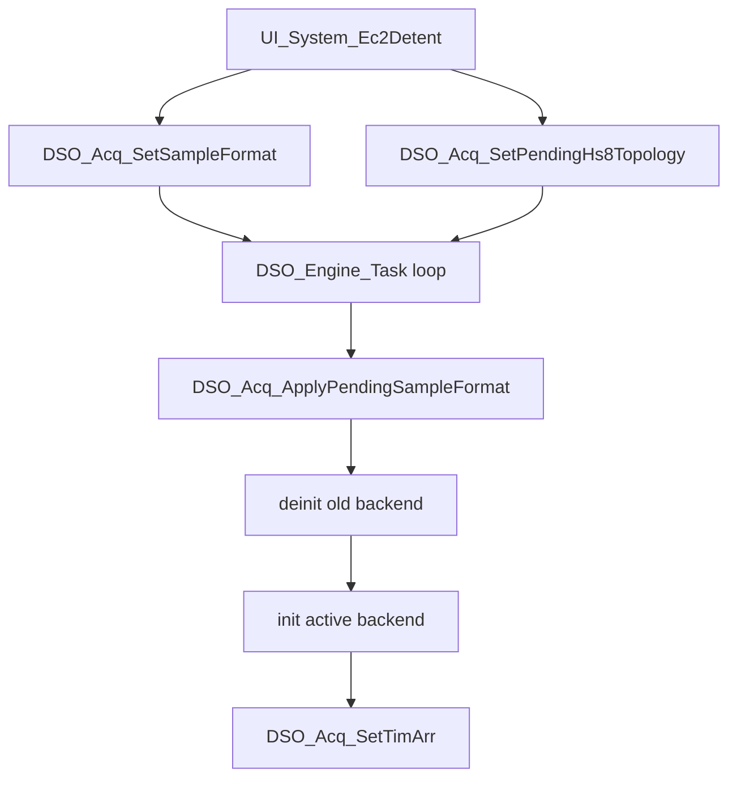

# 采集架构与采样模式

本文描述当前示波器 V2 底层移植目标下的采集模式、硬件触发、DMA ring、sample format 和 facade 分发关系。

## 产品采样格式

采样格式定义在 `User/dso/dso_sample_spec.h` 和 `User/dso/dso_sample_spec.c`。

| Format | 枚举 | ADC 位数 | adc_max | midscale | 目标 lane_count | CH2 | interleaved | 默认启动 |
| --- | --- | --- | --- | --- | --- | --- | --- | --- |
| 10-bit | `DSO_SAMPLE_FORMAT_10BIT` | 10 | 1023 | 512 | 2 | realtime | true | 否 |
| 8-bit high-speed | `DSO_SAMPLE_FORMAT_8BIT_HIGH_SPEED` | 8 | 255 | 128 | 3 | disabled | true | 是 |

默认格式：

```c
#define DSO_SAMPLE_FORMAT_DEFAULT DSO_SAMPLE_FORMAT_8BIT_HIGH_SPEED
```

默认格式为 `8-bit (3L)` 高速三路交织。
UI 只在 `10-bit` 与 `8-bit (3L)` 之间切换。

目标架构只有两条采集主线：

- `10-bit`：CH1 使用 ADC1/ADC2 双路交替采样，CH2 使用 ADC3 实时采样。
- `8-bit high-speed`：CH1 使用 ADC1/ADC2/ADC3 三路交替采样，CH2 在该模式下不可用。

迁移完成后，8-bit 不再保留 single safe 或 dual interleaved 产品路径。

## 采集 facade

`User/dso/dso_acq.c` 是采集统一入口。它的职责很窄：

- 保存当前已生效 sample format：`s_sample_format`。
- 保存 pending sample format：`s_pending_sample_format`。
- 迁移完成后，8-bit topology 固定为 tri interleaved，不再作为产品选项切换。
- 初始化/反初始化当前后端。
- 将统一 API 分发给 10-bit 或 8-bit 后端。

它不应该承载硬件细节。当前源码头注释也明确写明：

```text
8-bit and 10-bit backends own their hardware details.
This file only keeps the public mode switch, shared format state, and uniform dispatch surface.
```

### 统一 API 面

引擎主要依赖以下接口：

- `DSO_Acq_Init()`
- `DSO_Acq_Service()`
- `DSO_Acq_SetSampleFormat()`
- `DSO_Acq_ApplyPendingSampleFormat()`
- `DSO_Acq_GetSampleSpec()`
- `DSO_Acq_IsCh2Available()`
- `DSO_Acq_GetPos()` / `DSO_Acq_GetCh2Pos()`
- `DSO_Acq_GetBuf()` / `DSO_Acq_GetCh2Buf()`
- `DSO_Acq_GetSampleRate()` / `DSO_Acq_GetCh2SampleRate()`
- `DSO_Acq_GetLaneCount()`
- `DSO_Acq_SetTimArr()`
- `DSO_Acq_Start()` / `DSO_Acq_Stop()`
- `DSO_Acq_IsRunning()` / `DSO_Acq_IsDataReady()`
- `DSO_Acq_CopyRecentSamples()`
- `DSO_Acq_CopyNewSamples()`
- `DSO_Acq_CopyRecentCh2Samples()`
- `DSO_Acq_CopyNewCh2Samples()`
- `DSO_Acq_CheckOverrun()`
- `DSO_Acq_GetDebugSnapshot()`

这套接口是 engine 和采集后端之间的主要契约。

V2 RUN/STOP 修复迁移后，`DSO_Acq_Start()` / `DSO_Acq_Stop()` 仍保留为采集后端硬件生命周期接口，但手动 RUN/STOP 不应由 UI 直接调用它们。手动 STOP 使用 `run_requested=false` 冻结 engine 帧发布；真正的硬件 stop 只应出现在模式切换、SINGLE 捕获完成或后端错误恢复等明确场景。

## 10-bit 采集后端

10-bit 后端在 `User/dso/dso_acq_10bit.c`。

### 硬件模型

| 通道 | 引脚 | ADC | ADC channel | 触发 | DMA | 用途 |
| --- | --- | --- | --- | --- | --- | --- |
| CH1 lane0 | PA6 | ADC1 | CH3 | TIM1 CC1 | DMA1 Stream1 | CH1 偶数 lane |
| CH1 lane1 | PA6 | ADC2 | CH3 | TIM1 CC2 | DMA1 Stream2 | CH1 奇数 lane |
| CH2 | PC2 | ADC3 | CH0 | TIM1 CC3 | DMA2 Stream1 | CH2 实时通道 |

GPIO 初始化：

- PA6 配置为 analog。
- PC2 配置为 analog。
- `HAL_SYSCFG_AnalogSwitchConfig(SYSCFG_SWITCH_PC2, SYSCFG_SWITCH_PC2_CLOSE)` 打开 PC2 analog switch。

ADC 配置要点：

- 分辨率 `ADC_RESOLUTION_10B`。
- `ADC_CONVERSIONDATA_DMA_CIRCULAR`。
- ADC1/ADC2/ADC3 独立 DMA circular。
- ADC1 和 ADC2 都采同一个 CH1 输入 `ADC_CHANNEL_3`。
- ADC3 采 CH2 输入 `ADC_CHANNEL_0`。

### TIM1 三相触发

10-bit 后端使用 TIM1 三个 compare channel。当前 `dso_acq10_tim_trigger.c` 返回 `DSO_ACQ10_TIM_TRIGGER_MODE_PWM1`。

`tim1_cc_pulse(period, which)` 的相位：

| which | CCR | 位置 |
| --- | --- | --- |
| 0 | CCR1 | `period / 6` |
| 1 | CCR2 | `period / 2` |
| 2 | CCR3 | `period * 5 / 6` |

因此一个 TIM 周期内有三个触发点。CH1 使用前两个触发点形成双 lane 交织，CH2 使用第三个触发点实时采样。

### DMA buffer

10-bit 后端有三个 DMA ring：

```c
static uint16_t s_dma_lane0[DSO_DMA_BUF_SIZE] __attribute__((section(".RAM_D2"), aligned(32)));
static uint16_t s_dma_lane1[DSO_DMA_BUF_SIZE] __attribute__((section(".RAM_D2"), aligned(32)));
static uint16_t s_dma_ch2[DSO_DMA_BUF_SIZE]   __attribute__((section(".RAM_D2"), aligned(32)));
```

关键点：

- Buffer 放在 D2 SRAM，32 字节对齐。
- DMA half/full callback 分别 invalidate 前半区/后半区。
- `DSO_Acq10_GetPos()` 返回合并后的 common pos，而不是单个 ADC DMA pos。
- CH2 pos 独立由 ADC3 DMA counter 计算。

### CH1 lane 合并

CH1 的双 lane 合并由 `dso_lane_merge.c/.h` 提供窗口解析和对齐拷贝：

- `DSO_LaneMerge_ResolveCommonRecentWindow2()`
- `DSO_LaneMerge_ResolveCommonNewWindow2()`
- `DSO_LaneMerge_CopyAligned2()`

`dso_acq10_stream.c` 仍保留为纯 C lane 合并 helper 和 host test 覆盖对象，但当前 10-bit 后端读取 DMA ring 时已经改为先解析 common window，再对 lane0/lane1 的精确 ring 区间做 D-Cache invalidate，最后拷贝合并成按时间顺序排列的 `uint16_t` 样本序列。

合并前，10-bit 后端会维护 common position：

- 读取 ADC1/ADC2 DMA pos。
- 使用 `DSO_LaneMerge_CommonDelta2()` 计算两个 lane 共同推进量。
- 更新 `s_acq10.common_pos`。

### 采样率契约

10-bit 运行时信息由 `DSO_AcqModel_Build()` 构建。字段名中仍有 `tim8_*` 历史命名，但 10-bit 后端传入的是 TIM1 当前 clock。

正常 profile valid 时：

- `trigger_rate_hz = TIM1_CLK / (ARR + 1)`
- CH1 lane rate = `trigger_rate_hz`
- CH1 effective sample rate = `2 * trigger_rate_hz`
- CH2 sample rate = `trigger_rate_hz`

若 profile period 小于模型要求的最小周期，模型会按降级情况估算 sample rate。当前维护原则是不新增隐藏 fallback，而是让诊断暴露 profile 是否 valid。

### IRQ 和 callback

`User/dso/dso_acq_hal_stm32h7.c` 把中断统一接到 facade：

- `DMA1_Stream1_IRQHandler()` -> `DSO_Acq_DMA_IRQHandler()`
- `DMA1_Stream2_IRQHandler()` -> `DSO_Acq_DMA2_IRQHandler()`
- `DMA2_Stream1_IRQHandler()` -> `DSO_Acq_CH2_DMA_IRQHandler()`

HAL ADC callback：

- `HAL_ADC_ConvHalfCpltCallback()` -> `DSO_Acq_HandleAdcHalfTransfer()`
- `HAL_ADC_ConvCpltCallback()` -> `DSO_Acq_HandleAdcTransferComplete()`

facade 再根据当前 sample format 分发到 10-bit 或 8-bit 后端。

## 8-bit 采集后端

8-bit 后端在 `User/dso/dso_acq_8bit.c`。V2 移植目标是只保留三路交替采样：

| Topology | 常量 | 主要硬件模型 | CH2 可用性 |
| --- | --- | --- | --- |
| tri interleaved | `DSO_ACQ8_TOPOLOGY_TRI_INTERLEAVED` | ADC1/ADC2/ADC3 三 lane 均用于 CH1 | 不可用 |

默认 topology 在 `dso_config.h`：

```c
#define DSO_ACQ8_TOPOLOGY_DEFAULT DSO_ACQ8_TOPOLOGY_TRI_INTERLEAVED
```

### 8-bit 三路硬件模型

| Lane | 输入角色 | ADC | ADC channel | 触发 | DMA | 用途 |
| --- | --- | --- | --- | --- | --- | --- |
| CH1 lane0 | PA6 / CH1 | ADC1 | CH3 | TIM1 CC1 | DMA2 Stream0 | CH1 第 0 路 |
| CH1 lane1 | PA6 / CH1 | ADC2 | CH3 | TIM1 CC2 | DMA1 Stream0 | CH1 第 1 路 |
| CH1 lane2 | PC3 / CH1 第三路 | ADC3 | CH1 | TIM1 CC3 | DMA2 Stream1 | CH1 第 2 路 |

GPIO 初始化会打开 PA6、PC2、PC3 的 analog 配置，并打开 PC2/PC3 analog switch。迁移后的 8-bit 产品路径中 ADC3 不再作为 CH2 实时通道使用，而是固定作为 CH1 第三 lane；`DSO_Acq8_IsCh2Available()` 返回 false，`DSO_Acq8_GetCh2SampleRate()` 返回 0。

TIM1 相位与 10-bit 当前策略保持一致：

| CCR | 位置 |
| --- | --- |
| CCR1 | `period / 6` |
| CCR2 | `period / 2` |
| CCR3 | `period * 5 / 6` |

最快 8-bit tri 表使用 `DSO_ACQ8_TRI_INTERLEAVED_TIM_PERIOD_CLKS=18`，即 `ARR=17`。在 200 MHz TIM 时钟下，单 lane 约 11.111 MSPS，三路合并约 33.333 MSPS。

8-bit 关键辅助模块：

- `dso_acq8_sample_unpack.c`：低字节/高字节检测和解包。
- `dso_acq8_tim_trigger.c`：TIM trigger 模式，当前 PWM1。
- `dso_hs8_lane_cal.c`：8-bit lane 校准。
- `dso_hs8_render.c`：8-bit 高频增强渲染。

迁移后，旧的 single safe / dual interleaved 逻辑不作为 fallback 保留；8-bit 相关采集、校准和增强渲染都围绕三路交替采样这一条路径维护。

### ready gate 与 cache window

采集后端现在显式提供 ready 状态：

- 10-bit：`DSO_Acq10_IsDataReady()` 在后端 running 后返回 true。
- 8-bit：`DSO_Acq8_IsDataReady()` 需要三路 DMA 都推进过有效数据后才返回 true。
- facade：`DSO_Acq_IsDataReady()` 根据当前 sample format 分发。

Engine 在采样格式切换、非 gentle 时基切换或后端重启后，会等待 `DSO_Acq_IsDataReady()`，再恢复 record ingest、roll feed、trigger 分析和 frame 发布。这避免了刚启动 DMA 时读取未填充窗口导致直线、旧窗口或无效触发锚点。

DMA cache 策略也已经收敛：

- DMA 启动前调用 `prepare_all_dma_rx_buffers()`，对 RX ring 做 clean+invalidate。
- half/full callback 仍负责对应半区 invalidate。
- `CopyRecentSamples()` / `CopyNewSamples()` 在实际读 ring 前，会使用 `invalidate_dma_u16_window()` / `invalidate_dma_u16_recent()` 对精确窗口再 invalidate。
- 10-bit CH2 copy 同样在读 ADC3 ring 前做精确窗口 invalidate。

## 模式切换链路

UI 系统设置页通过 `UI_System_Ec2Detent()` 修改 pending 状态：

```text
8-bit high-speed + tri interleaved
  -> 10-bit
  -> 8-bit high-speed + tri interleaved
```

调用关系：



切换点在 engine 任务中，不在 UI 线程中直接 deinit/init ADC/DMA。

## CH2 采集策略

当前 CH2 采集只存在于 `10-bit` 模式：

- `10-bit`：ADC3/PC2 作为 CH2 实时通道，`DSO_Acq_IsCh2Available()` 返回 true，engine 可以使用 CH2 进行触发分析、显示同步、record view 和测量。
- `8-bit high-speed`：ADC3 被固定用于 CH1 第三 lane，`DSO_Acq_IsCh2Available()` 返回 false，`DSO_Acq_GetCh2SampleRate()` 返回 0，engine 会把 CH2 触发源规整回 CH1。

这条规则是当前架构边界：不要为了在 8-bit 下显示 CH2 而恢复旧 8-bit dual/CH2 realtime 路径。

## 外部测频输入

PB15/TIM12_CH2 外部频率计独立于 CH1/CH2 采集后端：

- GPIO：PB15，AF2，pulldown。
- 低频：TIM12 CH2 input capture，按周期换算 mHz。
- 高频：TIM12 external clock mode 1 gated count，由 DWT 周期计数作为 gate 参考。
- 模式选择：低频 capture 与 gated count 之间使用阈值和 hysteresis 切换。
- 状态输出：`VALID`、`WAIT_EDGE`、`MEASURING`、`NO_SIGNAL`、`OVERRANGE`、`FAULT`。

`DSO_Engine_Task` 上电默认调用 `DSO_FreqMeter_Init()` / `DSO_FreqMeter_Start()`，并在主循环中 `DSO_FreqMeter_Service(now)`；测量结果写入 `DSO_Frame.ext_freq_*` 字段供 UI 显示。

## ADC 时钟与相位基线

当前底层采用 V2 的 75MHz ADC core 基线：

- `DSO_ADC_CORE_TARGET_HZ = 75000000`
- Rev.Y / unknown 输入 ADC kernel clock 为 75MHz，core divider 为 1。
- Rev.V 输入 ADC kernel clock 为 150MHz，core divider 为 2，等效 ADC core 仍为 75MHz。
- 8-bit 路径保持三路交替采样，三路相位为 `1/6、1/2、5/6`。
- 10-bit 路径保持双路交替 + CH2 实时，TIM 相位为 `1/4、3/4、1/2`。

该模型按 independent ADC lane 建模，不再使用 packed dual-interleaved fallback。

目标 CH2 状态需要分格式理解：

- 10-bit：
  - sample spec 标记 `DSO_CH2_MODE_REALTIME`。
  - ADC3 始终作为 CH2 实时 DMA ring。
  - 引擎会分析、记录、渲染 CH2。
- 8-bit tri interleaved：
  - ADC3 是 CH1 第三 lane。
  - CH2 不可用。

UI 层的 channel enable 状态当前没有深度接入采集开关，更多是 UI 状态/预留 hook。
