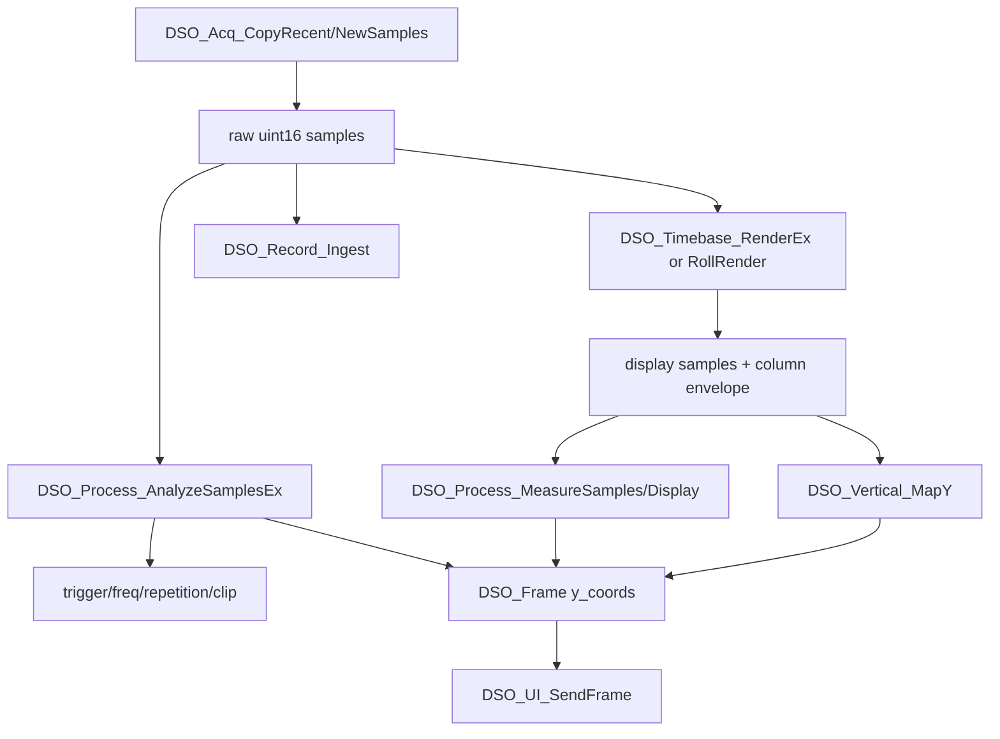

# 处理、时基、记录与渲染链路

本文记录采集样本进入引擎后的处理路径：触发/频率/测量、记录、时基渲染、Roll、垂直映射和最终 `DSO_Frame`。

## 核心数据流



## 采集控制

`User/dso/dso_acquire_control.c` 管理 trigger 和 acquisition 控制状态。

默认值：

| 字段 | 默认 |
| --- | --- |
| trigger mode | `DSO_TRIGGER_MODE_AUTO` |
| trigger slope | rising |
| trigger source | CH1 |
| trigger level | `DSO_VREF * 0.5f` |
| trigger level enabled | true |
| trigger position | 50% |
| acquire mode | sample |
| average depth | 8 |
| record depth | medium |
| pretrigger | 50% |
| single armed/captured | false |

采集模式枚举：

- `DSO_ACQUIRE_MODE_SAMPLE`
- `DSO_ACQUIRE_MODE_PEAK_DETECT`
- `DSO_ACQUIRE_MODE_HIRES`
- `DSO_ACQUIRE_MODE_AVERAGE`

当前 `format_supports_hires()` 对 `10-bit` 和 `8-bit high-speed` 都返回 true，所以 UI 循环顺序为：

```text
Sample -> Peak -> HiRes -> Average -> Sample
```

所有 `Set*` 接口先写 pending，engine 循环中调用 `DSO_AcquireCtrl_ApplyPending()` 生效。这样 UI 线程不直接打断正在进行的处理链路。

## 样本分析

`User/dso/dso_process.c` 负责原始样本分析。

主要输出结构是 `DSO_ProcessAnalysis`：

- `freq_hz`
- `freq_valid`
- `vmin`
- `vmax`
- `vavg`
- `trigger_index`
- `trigger_pos_samples`
- `triggered`
- `samples_per_cycle`
- `crossing_count`
- `period_jitter_pct`
- `repetitive_confidence`
- `clipped`

### 触发检测

`DSO_Process_AnalyzeSamplesEx()` 调用 `find_trigger_in_samples()`：

- 先扫描 vmin/vmax/vavg。
- 根据信号 vpp 与 hysteresis 判断是否足以触发。
- 触发电平由 `trigger_level_from_volts()` 从电压换算为 ADC code。
- 支持 rising/falling/both。`both` 会分别查找 rising 与 falling 交越，并选择更早的触发点。
- `trigger_level_enabled=false` 时，不使用手动电压阈值，而改用当前样本平均值附近的自适应触发电平。
- 输出整数 trigger index 和小数 trigger position。

当前主引擎 trigger config 包含 level、level enabled 和 slope。触发源由 `DSO_AcquireCtrlInfo.trigger_source` 指定：

- CH1：使用 CH1 analysis 作为 active trigger analysis。
- CH2：仅在 `DSO_Acq_IsCh2Available()==true` 时生效，使用 CH2 analysis 作为 active trigger analysis；record trigger 总索引按 CH2/CH1 sample rate 映射回 CH1 record 时间轴。
- CH2 不可用时，engine 调用 `DSO_AcquireCtrl_NormalizeTriggerSource(DSO_TRIGGER_SOURCE_CH1)` 规整回 CH1，并标记 control changed。

UI 触发 type 仍未进入底层策略；当前底层支持的是 edge trigger。

### 频率和重复性

`detect_freq_in_samples()` 基于 crossing 估算频率，并给出：

- crossing count。
- period jitter。
- samples per cycle。
- repetitive confidence。
- clipped 标记。

这些字段会影响：

- 是否使用 HS10/HS8 高频增强。
- 是否允许 ETS。
- 串口诊断输出。
- 频率显示是否可信。

### 测量

测量接口有两类：

- `DSO_Process_MeasureSamples()`：直接从 raw samples 计算 vmin/vmax/vpp/vavg/vrms/duty。
- `DSO_Process_MeasureDisplay()`：从渲染后的列数据或 min/max envelope 计算。

engine 对支持 raw preprocess 的路径优先使用 raw samples 测量；否则使用 display/envelope 测量。

## 时基表

`User/dso/dso_timebase.c` 维护 22 档时基。每个 entry 包含：

- index
- `sec_div_ns`
- mode：`TB_MODE_FAST`、`TB_MODE_NORMAL`、`TB_MODE_ROLL`
- timer ARR
- 标称硬件 sample rate

### 10-bit 时基表

`s_table_10bit`：

- index 0-5：FAST，100 ns/div 到 5 us/div，ARR 42，约 9.302 MSPS。
- index 6-15：NORMAL，10 us/div 到 10 ms/div，ARR 随档位变大。
- index 16-21：ROLL，20 ms/div 到 1 s/div，ARR 19999，20 kSPS。

### 8-bit 时基表

8-bit 现在只有一张产品表：

- `s_table_8bit_tri`：tri lane。

`active_8bit_table()` 固定返回 `s_table_8bit_tri`。旧 single lane / dual lane 表不再作为产品路径保留，也不再用 lane count 做 fallback 分支。

`s_table_8bit_tri`：

- index 0-10：FAST/NORMAL 前段统一使用 `DSO_ACQ8_TRI_INTERLEAVED_TIM_ARR`，当前为 `ARR=17`，三路合并标称 `33.333 MSPS`。
- index 11-15：NORMAL 中低速段使用 71、143、287、719、1439 等 ARR，标称采样率逐档下降。
- index 16-21：ROLL，ARR 29999，约 19.998 kSPS。

### active table

`active_table()`：

```text
active format == 8-bit high-speed
  -> active_8bit_table()
else
  -> s_table_10bit
```

因此 10-bit 和 8-bit 使用独立时基表，而不是靠同一张表套参数。

`active_sample_rate_from_entry()` 对 8-bit 会优先使用采集后端 runtime 中与当前 ARR 匹配的真实 `sample_rate_hz`；如果 runtime 尚未建立，则按 `TIM clock / (ARR + 1) * lane_count` 估算。当前 `DSO_SAMPLE_FORMAT_8BIT_HIGH_SPEED` 的 sample spec 已固定为 `lane_count=3`、`interleaved=true`、`CH2 disabled`。

## Normal/Fast 渲染

入口：

- CH1：`DSO_Timebase_RenderEx()`
- CH2：`DSO_Timebase_RenderToBufferForChannel()`

基本步骤：

1. 根据当前 timebase 和 sample rate 计算 `window_samples`：

   ```text
   window_samples = sample_rate * sec_div * 10
   ```

2. 如果有 trigger index，则按 trigger position pct 选择窗口起点。
   - CH2 作为触发源时，engine 先用 `DSO_TriggerDisplaySync_MapByRate()` 把 CH2 trigger position 映射到 CH1 render analysis，确保显示窗口围绕同一个物理时间点。
   - CH1 作为触发源时，同一 helper 把 CH1 trigger position 映射到 CH2 render analysis，保持双通道显示对齐。
3. 如果是 fast/sample 且信号满足重复性条件，尝试高级重建：
   - 10-bit CH1：HS10。
   - 8-bit 多 lane：HS8。
   - 其他满足条件路径：ETS。
4. 若高级重建不可用，走 direct window render：
   - 窗口样本数小于等于显示宽度：线性铺到 `DSO_DISPLAY_WIDTH`。
   - 窗口样本数大于显示宽度：按列做 min/max 或 sample decimation。
5. 输出：
   - `display_buf[channel]`
   - `display_buf_hi[channel]`
   - `DSO_RenderMeta`

`DSO_DISPLAY_WIDTH = 608`，`DSO_DISPLAY_HEIGHT = 248`，定义在 `User/dso/dso_config.h`。

## HS10 增强重建

HS10 在 `User/dso/dso_hs10_render.c`。

使用条件：

- 当前 sample format 是 `10-bit`。
- `DSO_10bitDisplaySync_AllowHs10ForChannel(channel)` 返回 true。
- 当前为 fast mode。
- acquire mode 为 sample。
- 频率有效。
- repetitive confidence >= 0.75。
- samples per cycle > 0 且 < 6.5。

当前 `DSO_10bitDisplaySync_AllowHs10ForChannel()` 只允许 CH1，所以 CH2 不走 HS10。

HS10 状态：

- 128 phase bins。
- 锁定频率变化超过 10% 时 reset。
- bin coverage >= 20% 时 ready。
- effective rate = `locked_freq_hz * 128`。

## HS8 和 ETS

HS8 用于 8-bit 多 lane 快速重复信号，状态在 `s_tb.hs8[channel]`。ETS 是通用等效采样路径，状态在 `s_tb.ets[channel]`。

二者由 `DSO_RenderPolicy_Decide()` 和 `DSO_Timebase_RenderToBufferForChannel()` 的 gate 条件共同控制。

Roll 模式不使用 ETS/HS8/HS10。`DSO_Timebase_ApplyPending()` 中对 Roll 的 reset 做了优化，避免每次 Roll step 都重置高级重建状态。

## Roll 渲染

Roll 入口：

- `DSO_Timebase_RollRender()`
- `DSO_Timebase_RollRenderForChannel()`

核心逻辑：

1. 用 `DSO_RollPhysics_SamplesPerPixel(sec_div_ns, sample_rate, DSO_DISPLAY_WIDTH)` 计算每个像素列对应的样本数。
2. 将新样本累加到 channel 的 `roll_accum_sum/count`。
3. 达到 samples-per-pixel 后生成一个显示列。
4. `roll_fill < DSO_DISPLAY_WIDTH` 时向右填充。
5. 满屏后左移一列并在最右写入新列。
6. 未填满的 tail 用 active sample spec 的 midscale 补齐。

Roll 历史 ring：

- engine 每轮调用 `engine_roll_ring_feed()` 将新样本追加到 `RollHistoryRing`。
- gentle roll timebase step 时，engine 尝试用历史 ring 重新 seed roll line。
- 内存来自 `roll_history_mem.c` 在 SDRAM 末端保留的 3 MB block。

## 外部测频帧字段

外部测频链路不替代 CH1/CH2 的样本分析频率；它是 PB15/TIM12 独立输入。engine 每次发布 frame 前调用 `DSO_FreqMeter_GetSnapshot()` 并填入：

| 字段 | 含义 |
| --- | --- |
| `ext_freq_valid` | 外部测频当前是否有效 |
| `ext_freq_state` | `DSO_FreqMeterState`，如 `VALID`、`NO_SIGNAL`、`OVERRANGE` |
| `ext_freq_mode` | 低频 capture 或高频 gated count |
| `ext_freq_millihz` | 64-bit 毫赫兹频率值 |
| `ext_freq_gate_us` | gated count 当前 gate 时间 |

UI 通过 `ui_freq_format.c` 格式化这些字段，`MainTask` header 使用 `EXT:%s` 展示。`frame.freq_hz` 和 `frame.ch2_freq_hz` 仍来自 CH1/CH2 样本分析，不能用外部测频覆盖。

## Record 链路

`User/dso/dso_record.c` 实现深存储。

深度：

| Depth | CH1 |
| --- | --- |
| short | 128K samples |
| medium | 1024K samples |
| deep | SDRAM record 区的 2/3 |

CH2：

- short/medium 是 CH1 的 1/2。
- deep 使用 SDRAM record 剩余 1/3。

正常运行时：

- 非 Roll 模式、采集运行中，engine 增量拷贝新样本并 `DSO_Record_Ingest()`。
- CH2 可用时 `DSO_Record_IngestCh2()`。
- 检测到 trigger 后 `DSO_Record_SetTrigger()`。
- single trigger 下调用 `DSO_Record_BeginSingleCapture()`，达到 stop 条件后 freeze，并由 engine 停止采集。

当 STOP、record view offset 非 0、窗口大于 recent buffer 时，engine 用 record view window 作为渲染源。

## 垂直映射

`User/dso/dso_vertical.c` 管理每个通道的：

- V/div index。
- volts per div。
- offset。
- probe x1/x10。
- coupling DC/AC/GND。
- scale min/max。

关键函数：

- `DSO_Vertical_MapYForChannel()`
- `DSO_Vertical_MapSampleToPlotYForChannel()`
- `DSO_Vertical_ApplyACDisplayFilterForChannel()`
- `DSO_Vertical_SampleToVolts()`

重要点：

- ADC LSB 电压使用 active `DSO_SampleSpec`：

  ```text
  adc_to_v = spec->vref / spec->adc_max
  ```

- GND coupling 会把样本替换为 active spec 的 midscale。
- AC coupling 使用简单高通状态，按当前 view time 更新 alpha。
- 映射结果是 plot 内 Y 坐标，范围 `0 .. DSO_DISPLAY_HEIGHT - 1`。

## `DSO_Frame`

`DSO_Frame` 定义在 `User/dso/dso_process.h`，是 engine 发往 UI 的完整帧结构。

包含：

- CH1/CH2 y 坐标。
- CH1/CH2 column envelope。
- 频率、采样率、触发状态。
- PB15/TIM12 外部测频状态和 mHz 结果。
- vpp/vmin/vmax/vavg/vrms/duty。
- CH2 对应测量。
- ETS/HS8/HS10 重建状态。
- overrun 计数。
- 校准状态。
- timebase 元数据。
- vertical 元数据。
- trigger/acquire/record 元数据。
- Roll 状态。

UI 不应重新理解原始 ADC ring；UI 的主输入应是 `DSO_Frame`。
