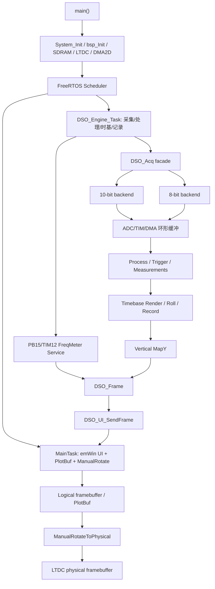

# 项目架构文档总览

本文档集基于当前 `/mnt/d/DSO_V8.1` 源码和 V2 底层移植目标整理，用于维护这个基于 STM32H743IIT6 的双通道示波器工程。内容重点记录模块边界、数据链路、运行时职责和维护约束。

## 快速结论

- 产品代码主要在 `User/` 下：
  - `User/dso/`：示波器核心链路，包括采集、时基、处理、记录、垂直映射、10-bit 校准、串口诊断。
  - `User/ui/`：emWin UI、波形绘制、PlotBuf、旋钮按键导航、触发/系统/通道页面。
  - `User/bsp/`：STM32H743 板级初始化、SDRAM、LCD RGB、UART、IO 扩展、显存布局。
  - `User/segger/`：SEGGER HardFault 处理。
- 当前默认上电采样格式是 `8-bit high-speed` 三路交替采样，定义在 `User/dso/dso_sample_spec.h` 与 `User/dso/dso_sample_spec.c`；系统设置页只在 `8-bit (3L)` 与 `10-bit` 两项之间切换。
- `User/dso/dso_acq.c` 是采集 facade，只负责模式状态和统一分发；10-bit 与 8-bit 硬件细节分别在专属后端中。
- 10-bit 当前链路是：
  - CH1：`PA6 / ADC1 CH3 + ADC2 CH3` 双 lane 交织，TIM1 CC1/CC2 触发。
  - CH2：`PC2 / ADC3 CH0` 实时采集，TIM1 CC3 触发。
  - DMA：ADC1 `DMA1_Stream1`，ADC2 `DMA1_Stream2`，ADC3 `DMA2_Stream1`。
- 8-bit high-speed 当前链路是：
  - CH1：ADC1/ADC2/ADC3 三 lane 交织，TIM1 CC1/CC2/CC3 触发。
  - ADC3 使用 `ADC_CHANNEL_1` 作为 CH1 第三 lane，8-bit 模式下 CH2 不可用。
  - DMA：ADC1 `DMA2_Stream0`，ADC2 `DMA1_Stream0`，ADC3 `DMA2_Stream1`。
- UI 显示采用逻辑横屏 `800x480` + 物理竖屏 `480x800`。波形区优先走 PlotBuf + DMA2D，最终由 `ManualRotateToPhysical()` 切到 LTDC 物理 framebuffer。
- V2 底层移植后的采样架构目标收敛为两条主线：`8-bit` 仅保留三路交替采样，`10-bit` 保留 CH1 双路交替 + CH2 实时采样。
- V2 中已修复的 RUN/STOP 波形冻结问题必须同步迁移：手动 STOP 采用 `run_requested` 逻辑暂停，engine 冻结帧发布，不再由 UI 直接物理启停 ADC/DMA。
- V2 的 PB15/TIM12 外部测频链路已经纳入当前工程，`DSO_Engine_Task` 上电默认 `Init/Start/Service` 测频模块；PB15 默认不再作为 LED4 GPIO 输出。
- 触发底层已经扩展为 CH1/CH2 触发源、rising/falling/both 边沿和触发电平 ON/OFF。8-bit 模式因 CH2 不可用会自动规整到 CH1。
- ADC 时钟/相位已经按 V2 收口：核心目标 75MHz，Rev.V 使用 150MHz 输入并通过 divider 回到 75MHz，10-bit TIM 相位为 `1/4、3/4、1/2`。
- PA4/DAC1 波形发生器已经迁入并默认开启，默认 profile 为 250kHz 方波；`DSO_TESTGEN_ENABLE` 与 `DSO_WAVEGEN_ENABLE` 编译期互斥。
- 串口基础波特率和 DSO/VOFA 诊断波特率统一为 1152000，但串口诊断本身仍默认关闭。
- UI 侧触发类型固定为 Edge，垂直默认挡位为 500mV/div。

## 文档目录

0. **[工程交接文档（含全量文件索引）](../交接文档.md)**
1. [项目结构与源码分层](01-project-structure.md)
2. [启动流程与 FreeRTOS 任务链路](02-runtime-task-flow.md)
3. [采集架构与采样模式](03-acquisition-and-sample-modes.md)
4. [处理、时基、记录与渲染链路](04-processing-timebase-rendering.md)
5. [UI、显示与输入链路](05-ui-display-and-input.md)
6. [BSP、内存、缓存、构建与测试](06-memory-bsp-build-test.md)
7. [维护边界、已知风险与审计清单](07-maintenance-boundaries-and-risks.md)
8. [V2 底层移植设计方案](08-v2-bottom-layer-port-design.md)
9. [V2 剩余底层迁移记录](09-v2-remaining-migration-stage4.md)
10. [V2 ADC 时钟/相位与波形发生器迁移记录](10-adc-clock-phase-wavegen-migration.md)
11. [FFT 频谱分析实施方案](11-fft-spectrum-analysis.md)

## 顶层运行链路

## 维护原则

- 文档里的模块职责应跟源码一致；如果改动了 `User/dso/`、`User/ui/` 或 `User/bsp/` 的链路，请同步更新对应文档。
- 新的 10-bit 工作应优先放在 10-bit 专属文件；8-bit 工作则收敛到三路交替采样主线，不再保留 single/dual 作为产品路径。
- 不要把临时 fallback、隐藏兼容分支、平行新旧路径写进架构主线。当前项目更适合单一路径、明确错误和针对性修复。
- `FreeRTOS/`、`emWin/`、`Libraries/` 视为 vendor 代码。除非显示链路必须改 `emWin/Config/LCDConf_Lin_Template.c`，否则优先在 `User/` 侧包裹或扩展。
