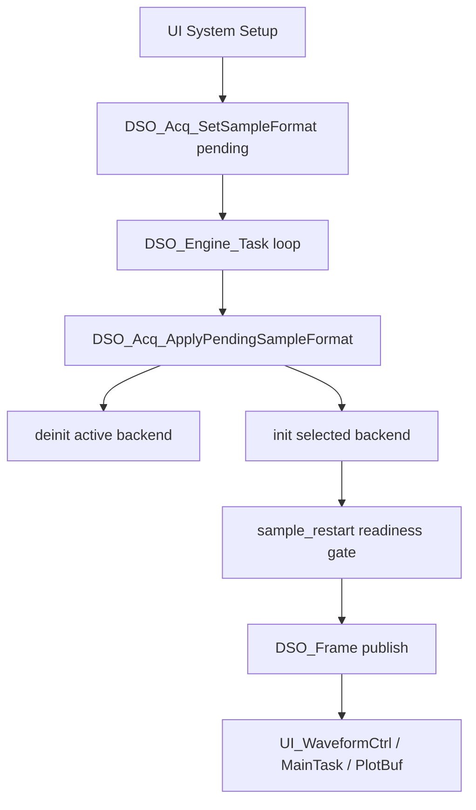
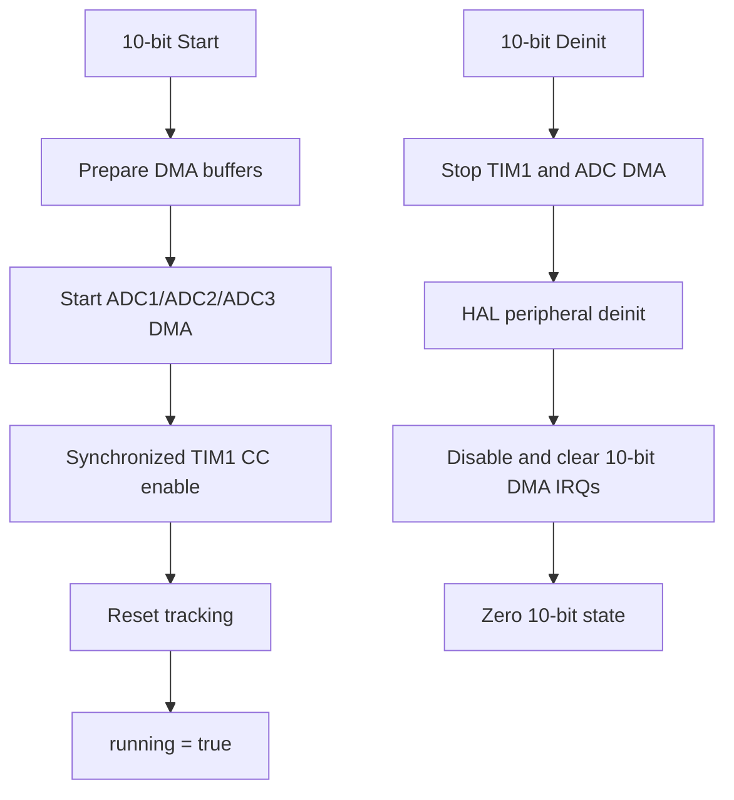

# DSO Mode Switch Waveform Spike Fix Design

Date: 2026-04-29
Status: Draft for project review

## Context

The current product acquisition paths are:

- `8-bit (3L)`: high-speed three-lane interleaved CH1 path, default product mode.
- `10-bit`: CH1 dual-lane interleaving with ADC1/ADC2 and realtime CH2 on ADC3.

Observed symptoms:

- Switching from `8-bit` to `10-bit` and then back can degrade `8-bit` waveform quality with visible spikes.
- `10-bit` waveform quality appears poor both at low and high frequency, and repeated mode switching does not materially change it.

The investigation points at acquisition backend behavior, not first at UI rendering:

- The UI only writes pending format state; the engine applies the actual backend switch.
- The engine already resets fast reconstruction state and waits for acquisition readiness after format changes.
- PlotBuf redraw can explain short-lived visual residue, but not persistent spikes in the sampled waveform.

## Goals

1. Remove the likely 10-bit lane-start skew that can create persistent CH1 interleave spikes.
2. Prevent 10-bit DMA interrupt residue from being dispatched into the 8-bit backend after a mode switch.
3. Preserve the frozen 8-bit acquisition architecture.
4. Keep the implementation single-path and explicit, with no hidden fallback or compatibility branch.
5. Add host-side contract tests that protect the mode-switch and 10-bit timing assumptions.

## Non-Goals

- Do not redesign the UI or PlotBuf path in this pass.
- Do not modify 8-bit lane topology, lane calibration, enhanced rendering, or sample merge behavior.
- Do not add automatic fallback between acquisition modes.
- Do not change 10-bit sample format, ADC channels, DMA stream ownership, or TIM1 phase targets.
- Do not change external frequency meter behavior.

## Current Chain



## Findings Behind This Design

### Finding 1: 10-bit PWM channel start is not synchronized

`DSO_Acq10_Start()` starts ADC DMA streams and then starts TIM1. In the PWM trigger path, TIM1 CH1, CH2, and CH3 are started through sequential `HAL_TIM_PWM_Start()` calls.

The 8-bit backend already has a stricter pattern:

1. Disable TIM1 counting.
2. Reset `CNT`.
3. Generate `UG`.
4. Enable CC1, CC2, and CC3.
5. Enable MOE.
6. Enable TIM1 once.

The 10-bit merge code assumes lane0 and lane1 ring indexes represent corresponding phase points. If CH1 and CH2 PWM outputs begin on different first cycles, the DMA streams may keep advancing at matching rates while staying permanently index-skewed. This matches the symptom that 10-bit quality is poor regardless of repeated switching.

### Finding 2: 10-bit deinit does not clear its DMA IRQs

The 8-bit backend clears DMA IRQ state during peripheral deinit. The 10-bit backend currently deinitializes its DMA handles but does not explicitly disable and clear pending IRQs for the DMA streams it owns:

- `DMA1_Stream1_IRQn` for ADC1 lane0.
- `DMA1_Stream2_IRQn` for ADC2 lane1.
- `DMA2_Stream1_IRQn` for ADC3 CH2.

IRQ dispatch is format-based in the acquisition facade. After switching from 10-bit to 8-bit, any leftover pending DMA IRQ can be dispatched through the now-active 8-bit path. This matches the symptom that 8-bit can degrade after a 10-bit round trip.

## Recommended Design

Implement one minimal backend fix in `User/dso/dso_acq_10bit.c`.



### 1. Add synchronized TIM1 PWM start for 10-bit

Add a 10-bit-local helper mirroring the 8-bit synchronized PWM start pattern:

- `TIM1->CR1 &= ~TIM_CR1_CEN`
- `TIM1->CNT = 0`
- `TIM1->EGR = TIM_EGR_UG`
- enable `TIM_CHANNEL_1`, `TIM_CHANNEL_2`, and `TIM_CHANNEL_3`
- `__HAL_TIM_MOE_ENABLE(&s_acq10.htim1)`
- `__HAL_TIM_ENABLE(&s_acq10.htim1)`

Use this helper only when `DSO_Acq10_GetTimTriggerMode() == DSO_ACQ10_TIM_TRIGGER_MODE_PWM1`.

The non-PWM timing path remains unchanged.

### 2. Add explicit 10-bit DMA IRQ cleanup

Add a 10-bit-local IRQ cleanup helper:

- `HAL_NVIC_DisableIRQ(DMA1_Stream1_IRQn)`
- `HAL_NVIC_ClearPendingIRQ(DMA1_Stream1_IRQn)`
- `HAL_NVIC_DisableIRQ(DMA1_Stream2_IRQn)`
- `HAL_NVIC_ClearPendingIRQ(DMA1_Stream2_IRQn)`
- `HAL_NVIC_DisableIRQ(DMA2_Stream1_IRQn)`
- `HAL_NVIC_ClearPendingIRQ(DMA2_Stream1_IRQn)`

Call it in `DSO_Acq10_Deinit()` after DMA deinit and before zeroing `s_acq10`.

This helper clears only the streams owned by the 10-bit backend. It must not clear 8-bit-only streams.

### 3. Keep UI behavior unchanged in this phase

No UI clearing, forced blank frame, or display fallback is added. If a visual-only residue remains after the acquisition fix, it should be handled as a separate UI frame invalidation design.

## Files

- Modify `User/dso/dso_acq_10bit.c`.
- Extend `tests/test_dso_acq10_sampling_chain_contract.c`, or add a focused test if keeping concerns separate is cleaner.
- No changes to `User/dso/dso_acq_8bit.c` are planned.
- No changes to `User/ui/*` are planned for this phase.

## Acceptance Criteria

1. 10-bit PWM trigger start no longer uses sequential `HAL_TIM_PWM_Start()` for CH1, CH2, and CH3.
2. 10-bit PWM trigger start enables all three CC channels before enabling TIM1.
3. 10-bit phase targets remain `1/4`, `3/4`, and `1/2`.
4. 10-bit deinit disables and clears pending IRQs for `DMA1_Stream1_IRQn`, `DMA1_Stream2_IRQn`, and `DMA2_Stream1_IRQn`.
5. 8-bit timing, topology, and lane calibration source files are not modified.
6. Existing host contracts still pass.

## Host Test Plan

Run:

```bash
./tests/test_dso_acq10_sampling_chain_contract.exe
./tests/test_dso_acq8_sampling_chain_protection.exe
./tests/test_dso_engine_8bit_ready_contract.exe
```

Add or extend contract coverage so failure occurs if:

- `DSO_Acq10_Start()` returns to sequential PWM channel start in the PWM1 path.
- The 10-bit synchronized PWM start no longer enables CH1, CH2, and CH3 before `__HAL_TIM_ENABLE`.
- `DSO_Acq10_Deinit()` stops clearing any of the three 10-bit DMA IRQs.

## Firmware Validation Plan

Use serial diagnostics and a stable signal source.

Sequence:

1. Boot in `8-bit (3L)` and observe stable waveform.
2. Switch to `10-bit`.
3. Observe CH1 lane0/lane1 windows, `phase_sync_errors`, `common_delta`, and `overrun_count`.
4. Switch back to `8-bit (3L)`.
5. Observe lane0/lane1/lane2 DMA rates, `phase_sync_errors`, and `overrun_count`.

Expected results:

- 10-bit `phase_sync_errors` does not grow continuously after startup.
- 10-bit lane0/lane1 windows are not fixed one-cycle apart.
- 10-bit overrun count does not grow continuously.
- Returning to 8-bit does not produce a burst of stray DMA activity or phase errors.
- The visible 10-bit spikes are reduced, and 8-bit does not degrade after a mode round trip.

## Rollback

If the synchronized TIM1 start worsens hardware behavior, revert only the 10-bit PWM start helper and keep the IRQ cleanup if it independently proves safe. No 8-bit rollback path is required because the design does not change 8-bit code.

